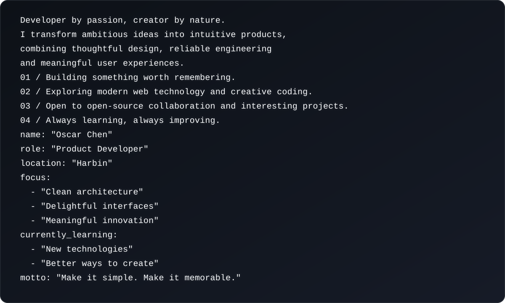

<!--
  GitHub Profile README for Oscar Chen (Nirvana3000).
  Remaining customization:
  1. Replace REPO_ONE and REPO_TWO with two public repositories you want to feature.
  2. Update the skills to match your actual stack.
  3. Replace the portfolio and LinkedIn URLs, or remove those buttons.
-->

  

<h1 align="center">Oscar Chen</h1>

  

  
  
  

 
<h2 align="center">01 / ABOUT ME</h2>

  

 
<h2 align="center">02 / TECH STACK</h2>

<strong>Frontend</strong>

  

<strong>Backend &amp; Cloud</strong>

  

<strong>Tools &amp; Workflow</strong>

  

 
<h2 align="center">03 / FEATURED WORK</h2>

A selection of projects that represent how I think, build and create.

  
  

  

 
<h2 align="center">04 / GITHUB ANALYTICS</h2>

  <picture>
    <source
      media="(prefers-color-scheme: dark)"
      srcset="https://github-readme-stats.vercel.app/api?username=Nirvana3000&cache_seconds=1800&show_icons=true&theme=tokyonight&hide_border=true&border_radius=12&rank_icon=github&include_all_commits=true"
    />
    <source
      media="(prefers-color-scheme: light)"
      srcset="https://github-readme-stats.vercel.app/api?username=Nirvana3000&cache_seconds=1800&show_icons=true&theme=default&hide_border=true&border_radius=12&rank_icon=github&include_all_commits=true"
    />
    
  </picture>
  <picture>
    <source
      media="(prefers-color-scheme: dark)"
      srcset="https://github-readme-stats.vercel.app/api/top-langs/?username=Nirvana3000&cache_seconds=1800&layout=compact&theme=tokyonight&hide_border=true&border_radius=12&langs_count=8&card_width=360"
    />
    <source
      media="(prefers-color-scheme: light)"
      srcset="https://github-readme-stats.vercel.app/api/top-langs/?username=Nirvana3000&cache_seconds=1800&layout=compact&theme=default&hide_border=true&border_radius=12&langs_count=8&card_width=360"
    />
    
  </picture>

 

  <picture>
    <source
      media="(prefers-color-scheme: dark)"
      srcset="https://streak-stats.demolab.com?user=Nirvana3000&cache_seconds=1800&theme=tokyonight&hide_border=true&border_radius=12&date_format=M%20j%5B%2C%20Y%5D"
    />
    <source
      media="(prefers-color-scheme: light)"
      srcset="https://streak-stats.demolab.com?user=Nirvana3000&cache_seconds=1800&theme=default&hide_border=true&border_radius=12&date_format=M%20j%5B%2C%20Y%5D"
    />
    
  </picture>

 
<h2 align="center">05 / LET'S CONNECT</h2>

  Great things start with a conversation. Feel free to reach out.

  
  
  

 

  

